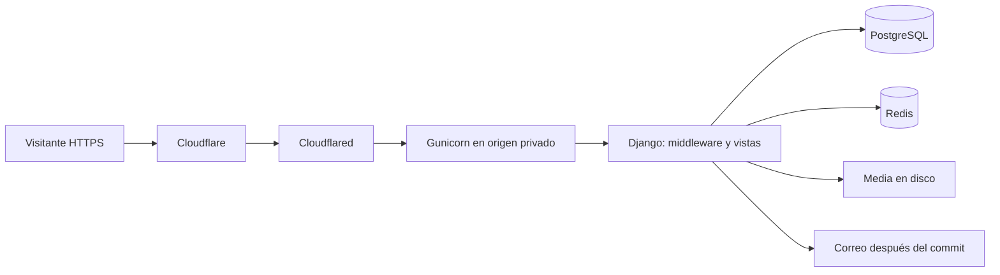
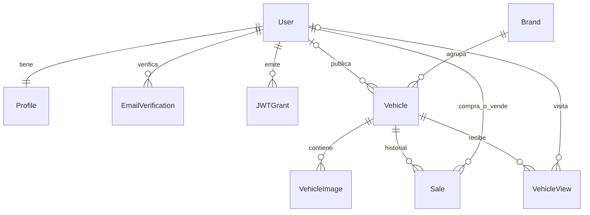

# Arquitectura

## Ejecución

TruckSmarter es un monolito Django 6.1 con plantillas de servidor. No usa Django REST Framework, Celery ni una SPA. La configuración admite WSGI y ASGI; el contenedor inicia Gunicorn WSGI. PostgreSQL almacena datos durables, Redis mantiene cuotas de peticiones y deduplicación rápida de visitas. Las imágenes usan FileSystemStorage.

La configuración efectiva está en `config/settings.py`; `config/test_settings.py` aísla correo, archivos y datos para pruebas. No confundir el acceso público mediante Cloudflared con la autenticación JWT propia del proyecto: los tokens no son tokens de Cloudflare Access.

## Estructura y dependencias

`core.permissions` define roles compartidos y `core.mixins` los aplica a vistas. `users.User` sustituye el usuario nativo de Django. `vehicles` depende del usuario y define la unidad comercial. `sales` conserva relaciones con vehículo, comprador y vendedor. `dashboard` reutiliza formularios y reglas de esas aplicaciones. `analytics` registra visitas del catálogo. No hay modelos propios de negocio en `core` o `dashboard`.

Un vehículo puede reservarse por un usuario (`reserved_by`, nullable). `JWTGrant.session_key` referencia por valor la sesión Django; no es una FK. Las visitas anónimas se identifican por sesión, no por IP.

## Escrituras y concurrencia

Las transiciones comerciales residen en `sales/workflow.py`. Cada operación es atómica y bloquea primero el vehículo con `select_for_update()`, después la oferta cuando corresponde. Mantener ese orden al ampliar la aplicación. `transaction.on_commit` envía notificaciones solo después del commit; un error SMTP se registra sin revertir una venta ya confirmada. No hay cola persistente ni reintento automático de correo.

Las restricciones SQL impiden precio/importe no positivo, oferta fuera de rango, dos ofertas pendientes del mismo comprador y vehículo, dos reservas vigentes o dos ventas finales de una unidad. Las FK `PROTECT` conservan el historial comercial. La retirada de un anuncio usa `is_active=False` y cierra alternativas; no elimina el vehículo.

El ORM, los formularios y los servicios cumplen funciones distintas: los formularios validan entrada, los servicios validan la transición bajo bloqueo y SQL impide estados incompatibles que atraviesen esos niveles. Evitar modificar `sold`, reservas o estados de venta directamente desde nuevos endpoints.

## Lecturas

El catálogo usa paginación de 12 unidades, `select_related` y un índice sobre disponibilidad/fecha. El panel usa páginas de 25 registros. Las visitas se deduplican durante 24 horas mediante Redis y una consulta persistente bajo bloqueo; el contador usa `F()` para evitar pérdidas de incrementos. Redis no contiene la fuente definitiva del historial.

## Cadena de seguridad

Primero se valida el peer Cloudflared si está habilitado; después se ejecutan HTTPS, CSP, guardia de peticiones, CORS y WhiteNoise, seguidos de sesiones, CSRF, autenticación y cabeceras. Revisar el orden real en `MIDDLEWARE` antes de insertar componentes. La guardia usa Redis; su caída produce 503 en rutas dinámicas. La deduplicación de analytics tiene fallback SQL, pero ese fallback no elimina la dependencia operativa de Redis para el acceso general.

## Límites actuales

No hay pagos, facturación, mensajería, API CRUD general, refresh JWT ni trabajos asíncronos. `VehicleImage` admite galería en datos/admin, pero no existe una API pública de gestión de galería. La infraestructura Cloudflare, las copias programadas y la entrega SMTP se validan durante despliegue, no con la suite de unidades.
